![ArchUnitNET][archunit-logo]
[archunit-logo]: img/ArchUnitNET-Logo.svg

# User Guide

## 1. Installation
To use ArchUnitNET, install the ArchUnitNET package from [NuGet](https://www.nuget.org/packages/TngTech.ArchUnitNET/):
```posh
PS> Install-Package TngTech.ArchUnitNET
```
If you want to use MSTestv2, xUnit or NUnit for your unit tests, you should instead install the corresponding ArchUnit extension:
```posh
PS> Install-Package TngTech.ArchUnitNET.MSTestV2
PS> Install-Package TngTech.ArchUnitNET.xUnit
PS> Install-Package TngTech.ArchUnitNET.NUnit
```
## 2. Quick Start

Create a test class to start testing. We used xUnit with the ArchUnit extension here, but it works similarly with NUnit or other Unit Test Frameworks.

Find this example code [here](https://github.com/TNG/ArchUnitNET/blob/master/ExampleTest/ExampleArchUnitTest.cs).
#### 2.1. Directives
```cs
using ArchUnitNET.Domain;
using ArchUnitNET.Loader;
using ArchUnitNET.Fluent;
using Xunit;

// Add a using directive to ArchUnitNET.Fluent.ArchRuleDefinition to easily define ArchRules
using static ArchUnitNET.Fluent.ArchRuleDefinition;
```

#### 2.2. Load Architecture
Load your architecture once at the start to maximize performance of your tests
replace <ExampleClass\> and <ForbiddenClass\> with classes from the assemblies you want to test
```cs
private static readonly Architecture Architecture =
    new ArchLoader().LoadAssemblies(
        System.Reflection.Assembly.Load("ExampleClassAssemblyName"),
        System.Reflection.Assembly.Load("ForbiddenClassAssemblyName")
    ).Build();
```
#### 2.2.1. Caching

ArchUnitNET uses two levels of caching to improve performance:

**Architecture Cache** — When you call `Build()`, the resulting `Architecture` is stored in a global singleton cache keyed by the loaded assemblies. If you load the same set of assemblies again (e.g., in a different test class), the cached architecture is returned instead of re-analyzing everything.

**Rule Evaluation Cache** — When architecture rules are evaluated, the filtered collections produced by object providers (e.g., `Types().That().ResideInNamespace(...)`) are cached within the architecture. If the same provider is used in multiple rules, the cached result is reused.

Both caches are enabled by default. You can configure them via `ArchLoader`:

```cs
// Disable both rule evaluation and architecture caching
private static readonly Architecture Architecture =
    new ArchLoader()
        .WithoutRuleEvaluationCache()
        .WithoutArchitectureCache()
        .LoadAssemblies(System.Reflection.Assembly.Load("ExampleClassAssemblyName"))
        .Build();
```

`WithoutRuleEvaluationCache()` disables the rule evaluation cache so that each call to `GetOrCreateObjects` always executes the provider's filtering logic. This is useful in test scenarios where you need to ensure every provider independently exercises its code path.

`WithoutArchitectureCache()` bypasses the global architecture cache, so each `Build()` call creates a fresh architecture instance. This is typically used together with `WithoutRuleEvaluationCache()` to avoid caching an architecture with non-standard caching settings in the global cache.

#### 2.3. Declare Layers
Declare variables you'll use throughout your tests up here
```cs
// Use As() to give your variables a custom description
private readonly IObjectProvider<IType> ExampleLayer =
    Types().That().ResideInAssembly("ExampleAssembly").As("Example Layer");

private readonly IObjectProvider<Class> ExampleClasses =
    Classes().That().ImplementInterface("IExampleInterface").As("Example Classes");

private readonly IObjectProvider<IType> ForbiddenLayer =
    Types().That().ResideInNamespace("ForbiddenNamespace").As("Forbidden Layer");

private readonly IObjectProvider<Interface> ForbiddenInterfaces =
    Interfaces().That().HaveFullNameContaining("forbidden").As("Forbidden Interfaces");

```
#### 2.4. Test Cases

Testing if above defined "ExampleClasses" reside in "ExampleLayer"
```cs
[Fact]
public void TypesShouldBeInCorrectLayer()
{
    IArchRule exampleClassesShouldBeInExampleLayer =
        Classes().That().Are(ExampleClasses).Should().Be(ExampleLayer);
    IArchRule forbiddenInterfacesShouldBeInForbiddenLayer =
        Interfaces().That().Are(ForbiddenInterfaces).Should().Be(ForbiddenLayer);

    // Check if your architecture fulfills your rules
    exampleClassesShouldBeInExampleLayer.Check(Architecture);
    forbiddenInterfacesShouldBeInForbiddenLayer.Check(Architecture);

    // You can also combine your rules
    IArchRule combinedArchRule =
        exampleClassesShouldBeInExampleLayer
		.And(forbiddenInterfacesShouldBeInForbiddenLayer);

    combinedArchRule.Check(Architecture);
}
```
Testing if the types in "ExampleLayer" depend on any object in "ForbiddenLayer"
```cs
[Fact]
public void ExampleLayerShouldNotAccessForbiddenLayer()
{
    // You can give your rules a custom reason, which is displayed when it fails
    // (together with the types that failed the rule)
    IArchRule exampleLayerShouldNotAccessForbiddenLayer = Types().That()
		.Are(ExampleLayer).Should().NotDependOnAny(ForbiddenLayer)
		.Because("it's forbidden");
    exampleLayerShouldNotAccessForbiddenLayer.Check(Architecture);
}
```
Testing naming of classes implementing "ForbiddenInterfaces"
```cs
[Fact]
public void ForbiddenClassesShouldHaveCorrectName()
{
    Classes().That().AreAssignableTo(ForbiddenInterfaces)
        .Should().HaveNameContaining("forbidden").Check(Architecture);
}
```
Testing if "ExampleClasses" call any method declared in "ForbiddenLayer" or with name containing "forbidden"
```cs
[Fact]
public void ExampleClassesShouldNotCallForbiddenMethods()
{
    Classes().That().Are(ExampleClasses).Should()
		.NotCallAny(MethodMembers().That()
		.AreDeclaredIn(ForbiddenLayer).Or().HaveNameContaining("forbidden"))
        .Check(Architecture);
}
```
## 3. What to Check
The following section illustrates some typical checks you could do with ArchUnitNET.

Find this example code [here](https://github.com/TNG/ArchUnitNET/tree/master/ExampleTest).

### 3.1. Namespace Dependency Rule
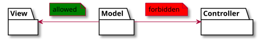
```cs
IArchRule rule = Types().That().ResideInNamespace("Model").Should()
                    .NotDependOnAny(Types().That().ResideInNamespace("Controller"));
```
### 3.2. Class Dependency Rule
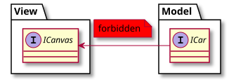
```cs
IArchRule rule = Classes().That().AreAssignableTo(typeof(ICar)).Should()
                    .NotDependOnAny(Classes().That().AreAssignableTo(typeof(ICanvas)));
```
### 3.3. Inheritance Naming Rule
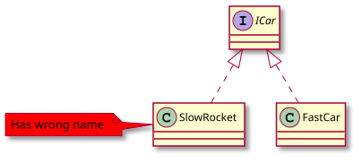
```cs
IArchRule rule = Classes().That().AreAssignableTo(typeof(ICar)).Should()
                    .HaveNameContaining("Car");
```
### 3.4. Class Namespace Containment Rule
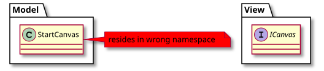
```cs
IArchRule rule = Classes().That().HaveNameContaining("Canvas").Should()
                     .ResideInNamespace(typeof(ICanvas).Namespace);
```
### 3.5. Attribute Access Rule
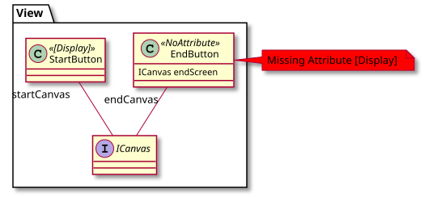
```cs
IArchRule rule = Classes().That().DoNotHaveAnyAttributes(typeof(Display)).Should()
                    .NotDependOnAny(Classes().That().AreAssignableTo(typeof(ICanvas)));
```

### 3.6. Slice Rules
Slices group types by namespace. A *slice* is the set of types whose namespaces produced the same
captured values from a pattern -- with `"App.(*)"`, the types in `App.Orders` form one slice, those in
`App.Shipping` another.

To use the `Slices()` entry point directly, add:
```cs
using static ArchUnitNET.Fluent.Slices.SliceRuleDefinition;
```

#### Pattern syntax
| Token    | Meaning |
|----------|---------|
| `(*)`    | Captures exactly one namespace segment. |
| `(**)`   | Captures one or more segments. |
| `(A\|B)` | Captures one of the listed alternatives. |
| `*`      | Matches one segment without capturing it. |
| `..`     | Matches zero or more segments. |
| `[A\|B]` | Matches one of the listed alternatives. |

A pattern must contain at least one capture group, may not mix `(*)` and `(**)`, and may use `(**)`
at most once. `Matching` throws an `ArgumentException` otherwise -- when the rule is defined, not when
it is checked. Types whose namespace does not match are left out entirely.

#### How slices are named
A slice is identified by **what its capture groups captured**, in group order. Two types end up in
the same slice exactly when their groups captured the same values. The pattern text between, before
and after the groups only selects which types belong to a slice: `"App.(*).(*)"`,
`"App.(*).Service.(*)"` and `"App.(*)..(*)"` all put the types they match in `Orders` and `Http`
into the same slice, while `"App.(**)"` over `App.Orders.Http` captures the single value
`Orders.Http`, which is a different slice.

A slice is named after its captures: `Slice ` followed by the captured values joined with ` - `. The
name never reads as a namespace, and it is what failure messages and diagrams show.

| Pattern | Namespace | Slice name |
|---|---|---|
| `App.(*)` | `App.Orders` | `Slice Orders` |
| `App.(**)` | `App.Orders.Web` | `Slice Orders.Web` |
| `App.(*)..` | `App.Orders.Web` | `Slice Orders` |
| `App.(*).(*)` | `App.Orders.Http` | `Slice Orders - Http` |
| `App.(*).Service.(*)` | `App.Orders.Service.Http` | `Slice Orders - Http` |
| `App.(*)..(*)` | `App.Orders.Web.Http` | `Slice Orders - Http` |
| `App.(*).*.(*)` | `App.Orders.Web.Http` | `Slice Orders - Http` |

Frozen violations of a slice rule (see `FreezingArchRule`) are stored by the slice name, e.g.
`Slice Orders`.

With `NestSlicesInPackages`, each slice is drawn under its name inside the package of the deepest
namespace all its types share (see [5.2](#52-structured-diagram-dependencies)). `Slice Orders - Http`
of `App.(*)..(*)` sits in `Orders` when its types are in `Orders.Web.Http` and `Orders.Api.Http`.

#### Cycle-free rule
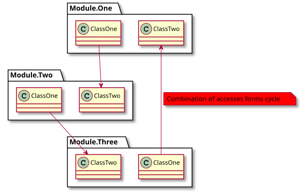
```cs
IArchRule rule = Slices().Matching("Module.(*)").Should()
                    .BeFreeOfCycles();
```

#### No-dependency rule
```cs
IArchRule rule = Slices().Matching("Module.(*)").Should()
                    .NotDependOnEachOther();
```
`NotDependOnEachOther` forbids *any* dependency between slices, where `BeFreeOfCycles` only forbids
circular ones.

## 4. How to check

To get a meaningful error message we recommend using
the xUnit or NUnit extension.

### 4.1 ArchUnitNET xUnit/NUnit extension

```cs
IArchRule someRule = ...;
someRule.check(Architecture);
```

### 4.2 ArchUnitNET no extension
```cs
IArchRule someRule = ...;
bool checkedRule = someRule.HasNoViolations(Architecture);
Assert.True(checkedRule);
```
### 4.3 PlantUML Component Diagrams as rules
ArchUnitNET can derive dependency rules from PlantUML diagrams. The rule can be created in the following way:
```cs
String myDiagram = "./Resources/my-diagram.puml";
IArchRule someRule = Types().Should().AdhereToPlantUmlDiagram(myDiagram);
someRule.Check(Architecture);
```
The diagrams must be component diagrams and associate types to components via stereotypes.
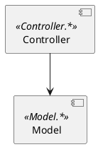
Consider this diagram applied as a rule via AdhereToPlantUmlDiagram(..), then a class that resides in the namespace Model accessing a class in the namepace Controller would be reported as a violation.

Only dependencies specified in the PlantUML diagram are considered. So any unknown dependency (e.g.  View.*) will be ignored.
#### 4.3.1 PlantUML Diagram rules

The rules that a PlantUML diagram used with ArchUnitNet must abide can be found in the [ArchUnit documentation](https://www.archunit.org/userguide/html/000_Index.html#_configurations_2). In contrast to ArchUnit ArchUnitNet uses a regex as the namespace identifier instead of the two dots syntax.

## 5. PlantUML file diagram builder
ArchUnitNET can build a dependency diagram from packages on its own. You can see some examples below.

### 5.1 Full diagram dependencies
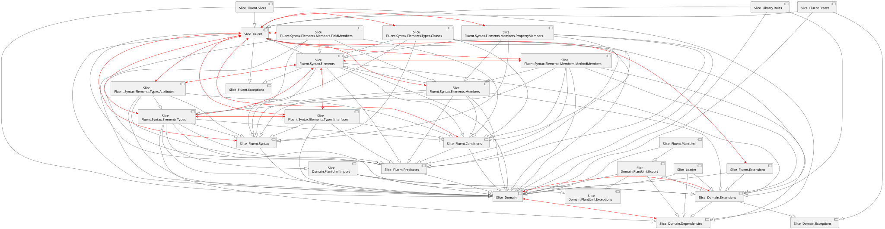
```cs
string pattern = "ArchUnitNET.(**)";
GivenSlices sliceRule = SliceRuleDefinition.Slices().Matching(pattern);
//Replace ArchUnitNET.Domain.Architecture with any class from your pattern
Architecture arch = new ArchLoader().LoadAssembly(typeof(ArchUnitNET.Domain.Architecture).Assembly).Build();

string path = "diagram.puml";

PlantUmlDefinition.ComponentDiagram().WithDependenciesFromSlices(sliceRule.GetObjects(arch)).WriteToFile(path);
```

### 5.2 Structured diagram dependencies
On the previous case there are too many dependencies, this option is suitable mainly for small projects / architectures / slices. With an increase in the number of objects, it makes sense to introduce another type of display - a display with packages. It differs from the previous case only in the `NestSlicesInPackages` option, which draws the namespaces as `package` blocks and each slice in the package of the deepest namespace that contains all of its types. A package that holds no slice and only one other package is merged with it, e.g. into `Orders.Domain`. A slice whose types share no namespace is drawn outside any package. This applies to every slice, also to those of `SlicedBy` and of custom assignments.

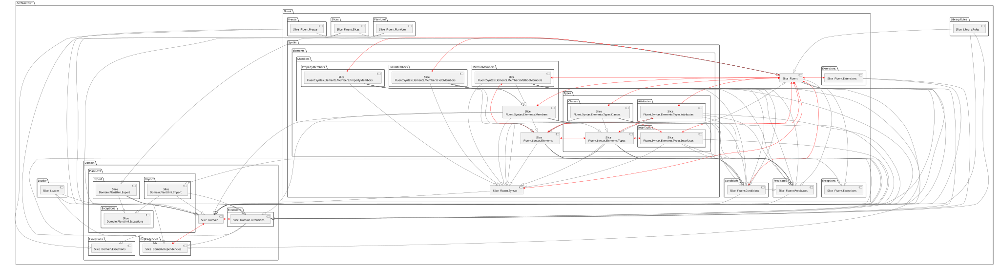
```cs
string pattern = "ArchUnitNET.(**)";
GivenSlices sliceRule = SliceRuleDefinition.Slices().Matching(pattern);
Architecture arch = new ArchLoader().LoadAssembly(typeof(ArchUnitNET.Domain.Architecture).Assembly).Build();
GenerationOptions g = new GenerationOptions(){NestSlicesInPackages = true};

string path = "diagram.puml";

PlantUmlDefinition.ComponentDiagram().WithDependenciesFromSlices(sliceRule.GetObjects(arch), g).WriteToFile(path);
```

### 5.3 LimitDependencies-mod
The previous case still shows a large number of connections. For maximum simplification, as well as demonstrating the overall picture, it makes sense to reformat it into a limited-dependencies version. This kind of display shows only dependencies between slices at the same depth, i.e. whose types share an equally deep namespace, nested or not.

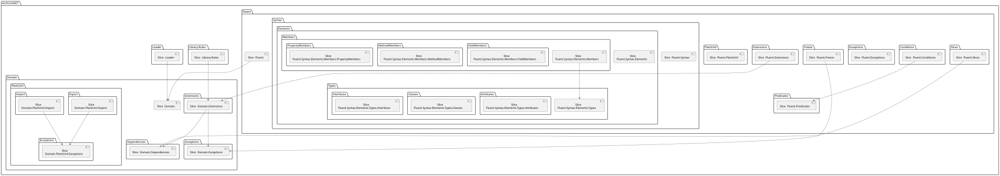
```cs
string pattern = "ArchUnitNET.(**)";
GivenSlices sliceRule = SliceRuleDefinition.Slices().Matching(pattern);
Architecture arch = new ArchLoader().LoadAssembly(typeof(ArchUnitNET.Domain.Architecture).Assembly).Build();
GenerationOptions g = new GenerationOptions(){NestSlicesInPackages = true, LimitDependencies = true};

string path = "diagram.puml";

PlantUmlDefinition.ComponentDiagram().WithDependenciesFromSlices(sliceRule.GetObjects(arch), g).WriteToFile(path);
```

### 5.4 Small slices
In order not to display all slices and all occurrences, you can use a single asterisk in the pattern. One star captures one namespace segment. You cannot mix single `(*)` and double `(**)` asterisks in one pattern, but you can repeat `(*)` -- `"ArchUnitNET.(*).(*)"` captures two segments and draws `Slice Fluent - Syntax` inside the `ArchUnitNET.Fluent.Syntax` namespace.

#### 5.4.1 ArchUnitNET.(\*)
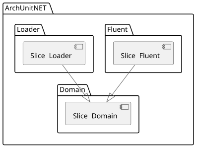
```cs
    string pattern = "ArchUnitNET.(*)";
    ...
```

#### 5.4.2 ArchUnitNET.(\*).(\*)
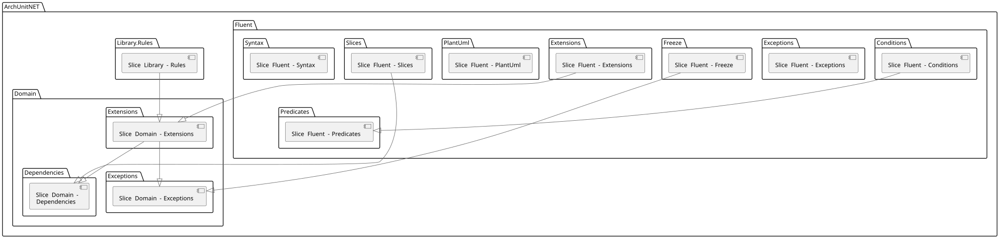
```cs
    string pattern = "ArchUnitNET.(*).(*)";
    ...
```

#### 5.4.3 ArchUnitNET.Fluent.(\*).(\*).(\*)
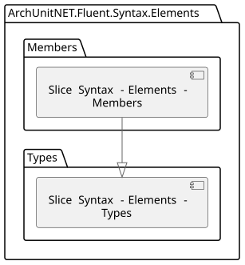
```cs
    string pattern = "ArchUnitNET.Fluent.(*).(*).(*)";
    ...
```

### 5.5 C4Style-mod

To enable an C4plantUML-style view of diagrams, set in the GenerationOptions flag C4Style = true.

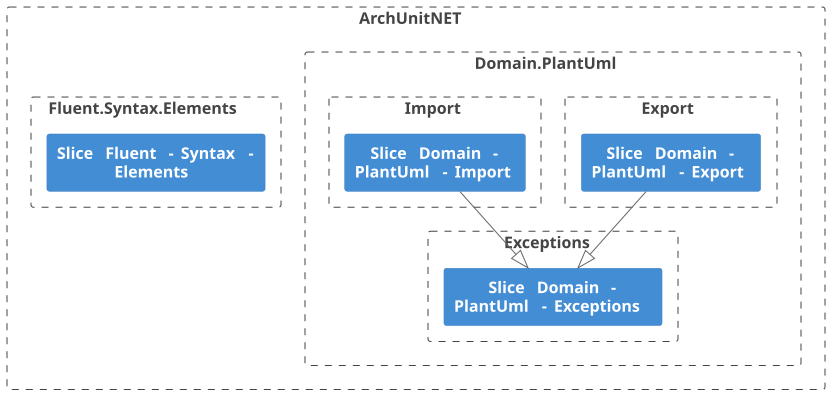
```cs
string pattern = "ArchUnitNET.(*).(*).(*)";
GivenSlices sliceRule = SliceRuleDefinition.Slices().Matching(pattern);
Architecture arch = new ArchLoader().LoadAssembly(typeof(ArchUnitNET.Domain.Architecture).Assembly).Build();
GenerationOptions g = new GenerationOptions(){NestSlicesInPackages = true, C4Style = true};

string path = "diagram.puml";

PlantUmlDefinition.ComponentDiagram().WithDependenciesFromSlices(sliceRule.GetObjects(arch), g).WriteToFile(path);
```

### 5.6 Focus-mod
Focus mod allows you to show all dependencies on the selected package or out of the package. The package to focus on is a namespace. A slice is focused when all of its types lie in it, flat or nested; slices that depend on it or that it depends on are drawn as well.

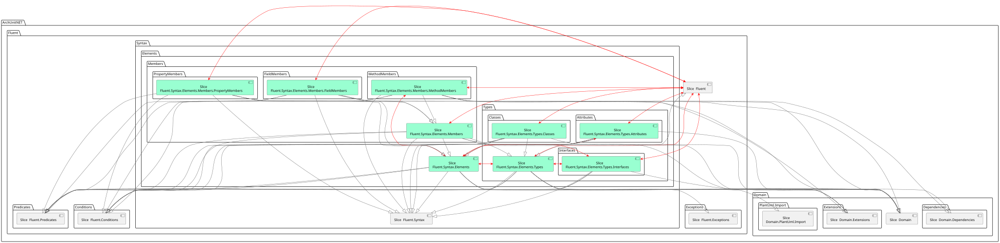
```cs
string pattern = "ArchUnitNET.(**)";
string focusOnThisPackage = "ArchUnitNET.Fluent.Syntax.Elements";
GivenSlices sliceRule = SliceRuleDefinition.Slices().Matching(pattern);
Architecture arch = new ArchLoader().LoadAssembly(typeof(ArchUnitNET.Domain.Architecture).Assembly).Build();
GenerationOptions g = new GenerationOptions(){NestSlicesInPackages = true};

string path = "diagram.puml";

PlantUmlDefinition.ComponentDiagram().WithDependenciesFromSlices(sliceRule.GetObjects(arch), focusOnThisPackage, g).WriteToFile(path);
```

### 5.7 Migrating from MatchingWithPackages
`MatchingWithPackages` is obsolete and will be removed in a future release. It creates the same slices
as `Matching`, with the same names and violations, and only nests them in diagrams. Replace
`MatchingWithPackages(pattern)` with `Matching(pattern)` and draw the slices with
`new GenerationOptions { NestSlicesInPackages = true }`. Diagrams change too: a slice is a box
inside its namespace instead of being drawn as that namespace.

Failure messages of former `MatchingWithPackages` rules no longer start a slice's name with the
namespace before the first capture group, and their frozen violations, which were stored under those
longer names, have to be frozen again once.

## 6. Further Reading and Examples
A complete overview of all available methods can be found [here](additional.md).

Check out example code on [Github](https://github.com/TNG/ArchUnitNET/tree/master/ExampleTest "ExampleTests").
